<h1 align="center">🧾 SuperSu · 发票智能处理系统</h1>

<p align="center">
  <strong style="font-size:18px">停止手工抄单。让发票自己走进台账。</strong><br>
  每月几十张发票的录入、查重、归档、统计 —— 压缩成一次拖拽。
</p>

<p align="center">
  
  
  
  
  
  
  
</p>

<p align="center">
  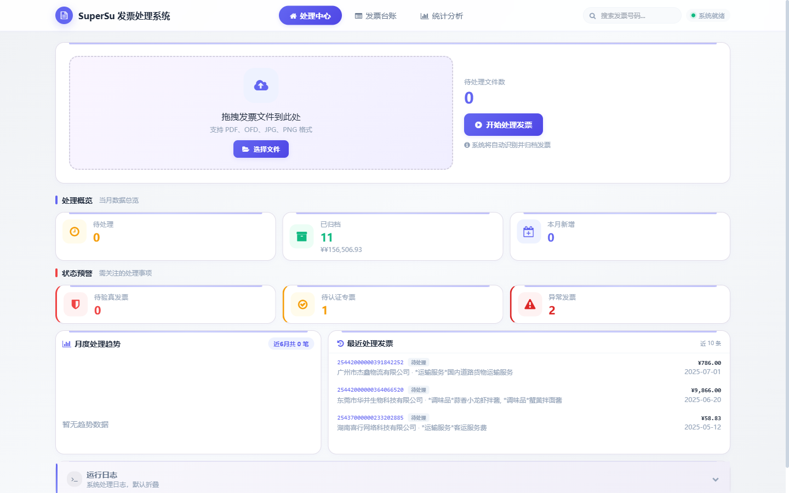
  <br><sub>▲ 处理中心实拍 · 拖拽上传、处理概览、状态预警、趋势与最近记录，一屏尽览</sub>
</p>

<p align="center">
  <a href="#sec-start"><b>立即开始 →</b></a> ·
  <a href="#sec-features">功能实拍</a> ·
  <a href="#sec-roi">效率账本</a> ·
  <a href="#sec-arch">系统架构</a>
</p>

---

## 目录

| | | |
|:--|:--|:--|
| [01 · 先把账算清楚](#sec-why) | [02 · 产品全景](#sec-overview) | [03 · 一次拖拽之后](#sec-flow) |
| [04 · 功能特色（全实拍）](#sec-features) | [05 · 效率账本](#sec-roi) | [06 · 3 分钟跑起来](#sec-start) |
| [07 · 系统架构](#sec-arch) | [08 · 配置参考](#sec-config) | [09 · 质量与可信度](#sec-quality) |
| [10 · 适用边界](#sec-scope) | [11 · 版本足迹](#sec-changelog) | [12 · 常见问题](#sec-faq) |

---

<a id="sec-why"></a>

## 🧮 01 · 先把账算清楚

发票不难，难的是**它每个月都来一遍**。真正吃掉时间的从来不是"识别"这一个动作，而是围绕它的整条手工流水线：

| 每月重复发生的事 | 人工做法 | 真正被吃掉的成本 |
|:--|:--|:--|
| 录入 20 张票 | 逐张打开 PDF，抄号码、金额、税号到 Excel | 约 60 分钟／月，且伴随录入误差 |
| 查重 | 在 Excel 里肉眼搜发票号 | 重复报销一旦漏网，损失是**全额** |
| 归档 | 手动建年/月文件夹、改文件名 | 找一张半年前的票，翻 5 分钟起 |
| 出统计 | 月底临时汇总、手动拉透视表 | 老板要数的时候，你还在对账 |
| 抵扣追踪 | 靠备忘录记专票认证期限 | 超期 = 进项税白白流失 |

> **真正贵的不是那 60 分钟，而是「票在、数据不在」。**
> 所有信息都锁在 PDF 里，查不了、算不了、追不了。等到要统计、要审计、要抵扣时，只能重新人肉翻一遍。

### 前后对比

| | 之前（人工） | 之后（SuperSu） |
|:--|:--|:--|
| 录入 | 3 分钟／张，手抄 | 批量拖拽，秒级入库 |
| 查重 | 事后肉眼比对 | **入库即时双重拦截** |
| 归档 | 手动建目录 | 按年/月自动归位，失败落盘可重投 |
| 统计 | Excel 透视表临时拼 | 打开统计页，数字已经在等你 |
| 数据 | 散落在文件夹 | SQLite 结构化，随时导出 CSV |
| 风险 | 出事才发现 | 大额／拆票／超期，提前标红 |

---

<a id="sec-overview"></a>

## 🖥 02 · 产品全景：三大工作台

<table>
<tr>
<td width="33%" align="center" valign="top">

**🟣 处理中心**

*拖进去，就完事*

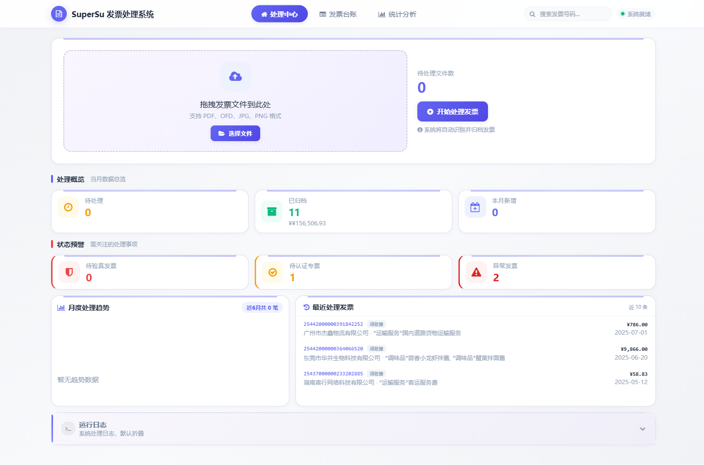

上传、概览、预警、趋势、运行日志。所有动作从一个入口开始。

</td>
<td width="33%" align="center" valign="top">

**🔵 发票台账**

*每一张票都查得到*

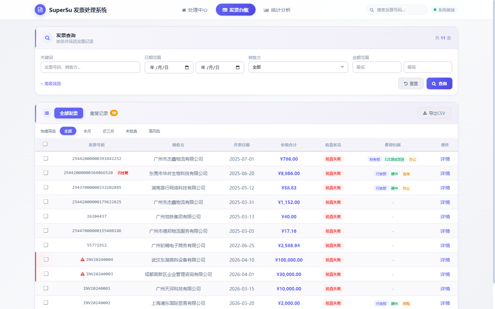

多维筛选、快捷标签、表头排序、批量操作、CSV 导出。

</td>
<td width="33%" align="center" valign="top">

**🟢 统计分析**

*数字自己会说话*

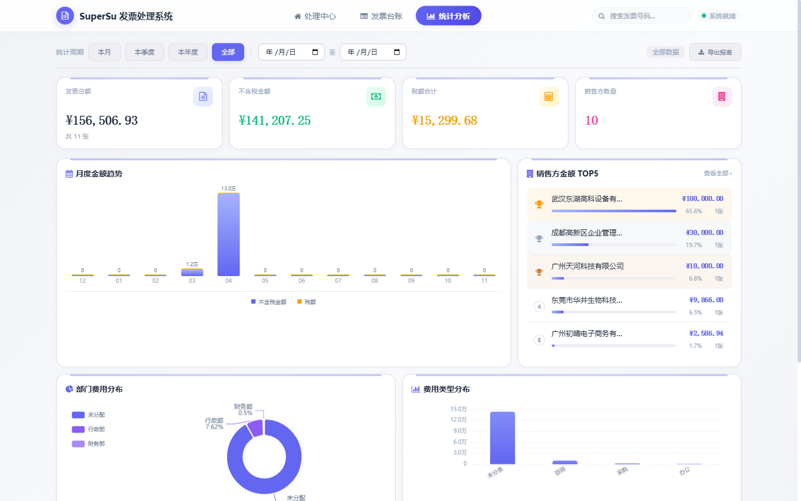

总额、税额、销售方 TOP5、月度趋势、费用分布，一屏给全。

</td>
</tr>
</table>

> 📸 **关于本页所有图片**：全部来自**实际运行的系统实拍**，演示库为真实数据 ——
> **11 张发票 · ¥156,506.93 · 10 家销售方 · 19 条重复拦截记录 · 2 条异常标记**。
> 说明：演示库中包含 4 条构造样例（INV20240001–INV20240004），其余为真实台账；
> 截图未做任何界面修饰。

---

<a id="sec-flow"></a>

## ⚙ 03 · 一次拖拽之后，系统替你做了什么

<p align="center"></p>
<p align="center"><sub>▲ 上传区实拍 · PDF / OFD / JPG / PNG，一个入口全部收下</sub></p>

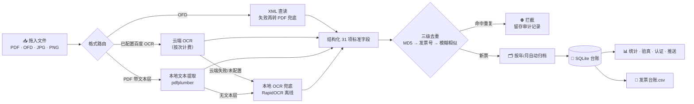

**一句话**：你只做一次拖拽，剩下的格式判断、字段抽取、去重判定、归档归位、台账落库、统计更新，全部在后台线程里自己跑完 —— 界面不卡，你可以继续干别的。

---

<a id="sec-features"></a>

## ✨ 04 · 功能特色（每一条都有实拍）

### 4.1 · 四种格式，一个入口

不用先转格式、不用先装阅读器。**OFD 直接读内嵌 XML**（最快最准），带文本层的 PDF 走本地提取，扫描件和照片交给 OCR —— 三条路在同一个上传区汇合。识别失败的文件不会被静默丢掉，而是落入 `识别失败待处理/`；下次运行自动重投，超过 3 次不再自动回流，避免反复消耗额度。

- **你得到什么**：不挑文件、不挑来源，一次拖拽批量入库
- **实拍**：[上传区](docs/screenshots/02-upload-zone.png) · [处理中心全页](docs/screenshots/03-dashboard-full.png)

---

### 4.2 · 重复报销，进门就被拦下

文件指纹（MD5）+ 发票号码**双重判定**。同一张票换个文件名、换个人提交，照样命中；命中的不删除、不覆盖，而是单独记入重复记录台账，留发票号、销售方、金额、重复类型、原始文件名和检测时间 —— 事后要审计，证据是齐的。

<p align="center">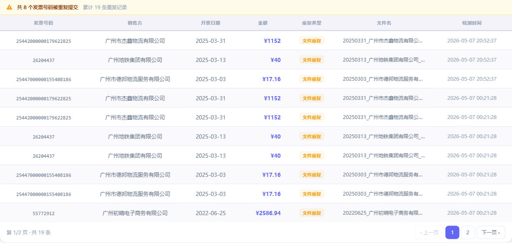</p>
<p align="center"><sub>▲ 重复记录 Tab 实拍 · 8 个发票号码被重复提交，累计 19 条拦截记录，条条可追溯</sub></p>

- **你得到什么**：把"事后追款"变成"事前拦截"

---

### 4.3 · 台账不是 Excel，是能查能筛能排的工作台

关键词、日期、销售方、金额、发票类型、推送状态、验真状态**组合筛选**；「全部 / 本月 / 近三月 / 未验真 / 高风险」一键切换；开票日期与价税合计点击即排序；勾选后批量验真、批量认证、批量设置归属、导出 CSV 一气呵成。

<table>
<tr>
<td align="center" valign="top"><b>多维组合筛选</b><br><br></td>
<td align="center" valign="top"><b>快捷筛选 · 排序 · 批量操作 · 风险行高亮</b><br><br>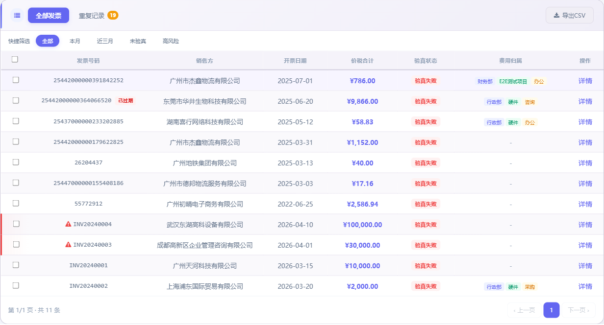</td>
</tr>
</table>

- **你得到什么**：找一张历史票，从"翻 5 分钟"变成"输 5 秒"

---

### 4.4 · 从一张票的全息档案，到一批票的合规闭环

点开任意一张票：发票号码、代码、类型、购销双方及税号、不含税金额、税率、税额、价税合计、项目内容、备注、费用归属、验真结果、认证状态、原件入口 —— 全部摊开在一张卡片上。往上一层，勾选多张即可批量验真（下单前先给费用预估），批量标记专票已认证，进项税抵扣进度一路可追。

<table>
<tr>
<td align="center" valign="top"><b>发票详情 · 全字段档案</b><br><br>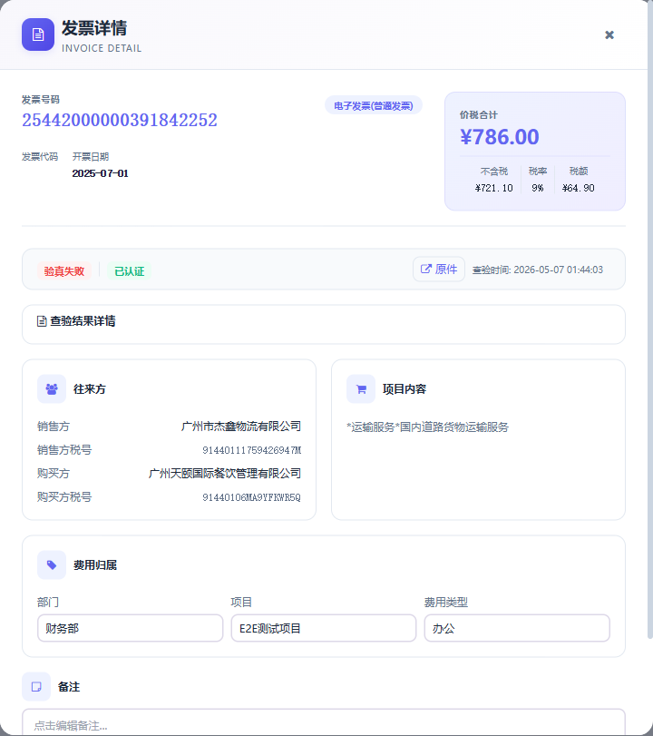</td>
<td align="center" valign="top"><b>批量验真 · 费用前置确认</b><br><br>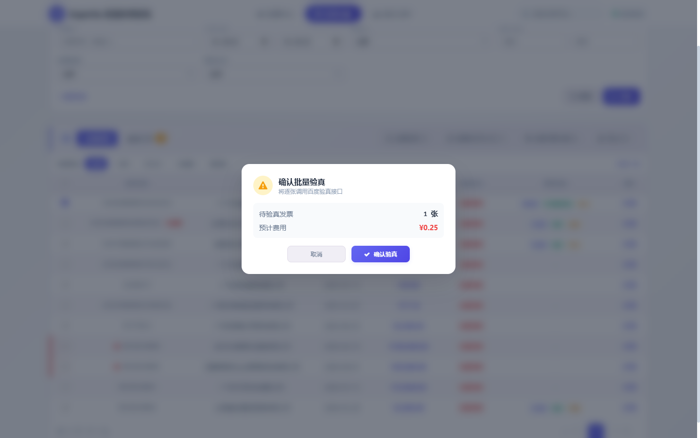</td>
</tr>
</table>

- **你得到什么**：单张查得清、批量跑得动，验真花多少钱在点下去之前就知道

---

### 4.5 · 风险不用等出事才发现

单张大额、疑似拆票自动打标，风险行在台账里左侧标红；处理中心的「状态预警」把待验真、待认证专票、异常发票三件事单独拎出来；统计页底部还有专门的异常发票提醒列表，点一行直达详情。专票 360 天抵扣期限自动预警，已过期／即将到期分得清清楚楚。

<p align="center">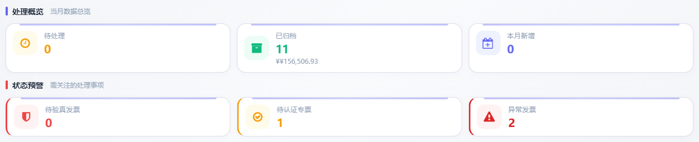</p>
<p align="center"><sub>▲ 处理概览 + 状态预警实拍 · 11 张已归档 / ¥156,506.93 / 1 张待认证专票 / 2 条异常标记</sub></p>

<p align="center">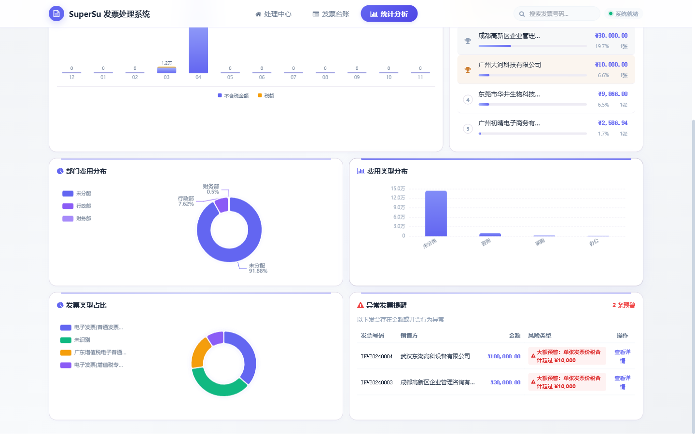</p>
<p align="center"><sub>▲ 部门费用分布、费用类型分布与异常发票提醒实拍</sub></p>

- **你得到什么**：风险从"月底复盘"前移到"入库当天"

---

### 4.6 · 老板要的数，打开就有

发票总额、不含税金额、税额合计、销售方数量四张指标卡；月度价税堆叠趋势、销售方金额 TOP5（点名字直接跳台账并自动筛选）、部门／费用类型分布、发票类型占比饼图。「本月 / 本季度 / 本年度 / 全部」加任意日期范围自由切换，结果一键导出 CSV 报表。

<p align="center">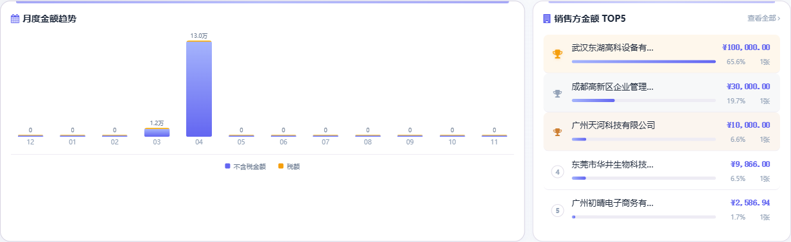</p>
<p align="center"><sub>▲ 月度金额趋势与销售方 TOP5 实拍 · 全部基于真实台账数据实时计算</sub></p>

- **你得到什么**：统计不再是"月底加个班"，而是"随时打开看一眼"

---

### 4.7 · 每张票都知道「花在谁身上」

部门、项目、费用类型三层标签，支持批量统一设置；设置结果直接进详情页的「费用归属」区块，并反过来喂给统计页的部门／费用分布图。录票时多花的 3 秒，换年底不用再重新分类 200 张票。

<p align="center">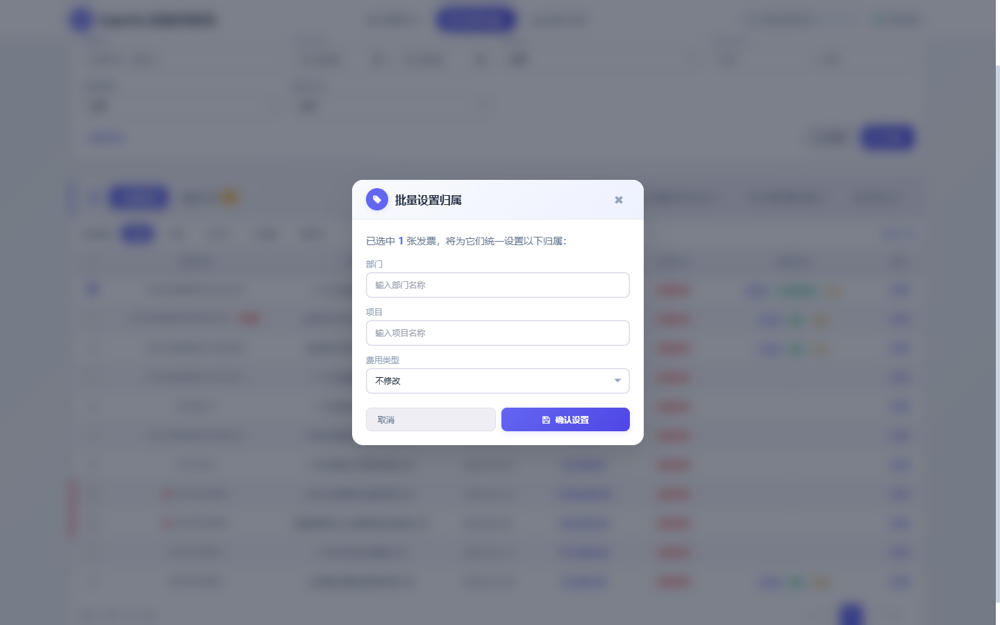</p>
<p align="center"><sub>▲ 批量设置归属实拍 · 一次勾选，统一填写部门 / 项目 / 费用类型</sub></p>

- **你得到什么**：从"记一笔账"升级成"能按部门、按项目复盘的成本数据"

---

### 4.8 · 电脑、平板、手机，打开就能用

响应式布局不是把桌面版硬压窄：导航收成图标、卡片改单列、按钮放大到可点。再往上，还有免安装绿色便携包 —— 不带 Python 环境也能双击运行，数据全部留在本地。

<p align="center">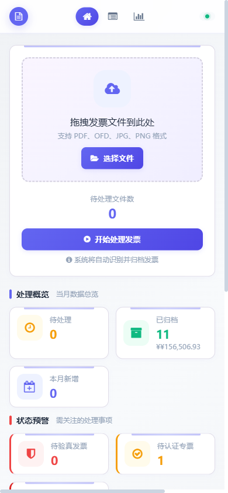</p>
<p align="center"><sub>▲ 390px 手机视口实拍 · 导航、上传区、概览卡片完整适配</sub></p>

- **你得到什么**：在哪台设备上都能查票，不必守着那台装了环境的电脑

---

<a id="sec-roi"></a>

## 📈 05 · 效率账本

| 指标 | 人工 | SuperSu | 变化 |
|:--|:--|:--|:--|
| 单张录入 | ≈ 3 分钟 | ≈ 3 秒 | **↓ 约 60×** |
| 20 张批量入库 | ≈ 60 分钟 | 一次拖拽 | 降到 1 次操作 |
| 重复报销发现 | 事后 / 靠运气 | 入库即时拦截 | 事后 → 事前 |
| 找一张历史票 | 翻文件夹 ≈ 5 分钟 | 关键词搜索 ≈ 5 秒 | **↓ 约 60×** |
| 全年统计汇总 | 临时汇总数小时 | 打开页面即见 | 批量 → 实时 |
| 专票抵扣超期 | 靠备忘录 | 360 天自动预警 | 被动 → 主动 |

<sub>以每月 20 张发票的典型场景估算，用于说明流程差异，非基准测试值。</sub>

> **算笔实在账**：每月省下约 1 小时录入 + 临时统计的加班时间，更关键的是把「重复报销」和「超期抵扣」这两件一旦发生就是真金白银损失的事，从人盯变成系统盯。

---

<a id="sec-start"></a>

## 🚀 06 · 3 分钟跑起来

```bash
# 1 · 安装依赖（Python 3.9+）
pip install -r system/requirements.txt

# 2 · 可选：配置 OCR / 验真 / 企微推送（不配也能跑）
cp .env.example .env

# 3 · 启动
双击 🚀 一键启动.bat      # Windows，自动开浏览器
python api_server.py       # 任意平台通用

# 4 · 打开 http://localhost:5000  →  把发票拖进去
```

**就这么四步。** 没有数据库要装，没有服务要编排，没有账号要注册 —— SQLite 自动建库，目录自动创建，浏览器自动打开。

### 三种部署方式，按需挑一种

| 方式 | 适合谁 | 一条命令 | 特点 |
|:--|:--|:--|:--|
| **本地直跑** | 日常自用、开发调试 | `python api_server.py` | 零配置，改完立即生效 |
| **Docker** | 想在 NAS / 服务器上常驻 | `docker build -t invoice-system .` | 环境隔离，需挂载数据目录（见下） |
| **绿色便携包** | 给不懂命令行的同事 | `python build_portable.py` | ≈38MB，免 Python，双击即用 |

```bash
# Docker（数据目录必须挂载，否则重建容器会丢台账/归档/CSV）
docker build -t invoice-system .
docker run -d -p 5000:5000 \
  -v ./system/data:/app/system/data \
  -v ./已归档发票:/app/已归档发票 \
  -v ./重复发票记录:/app/重复发票记录 \
  -v ./识别失败待处理:/app/识别失败待处理 \
  -v ./待识别发票:/app/待识别发票 \
  -v ./发票台账.csv:/app/发票台账.csv \
  invoice-system

# 生成便携包
python build_portable.py     # 输出 dist/portable/
```

> ⚠️ 只挂 `待识别发票` 是不够的：数据库、归档原件、CSV 台账都在容器内，重建即丢。

---

<a id="sec-arch"></a>

## 🏗 07 · 系统架构

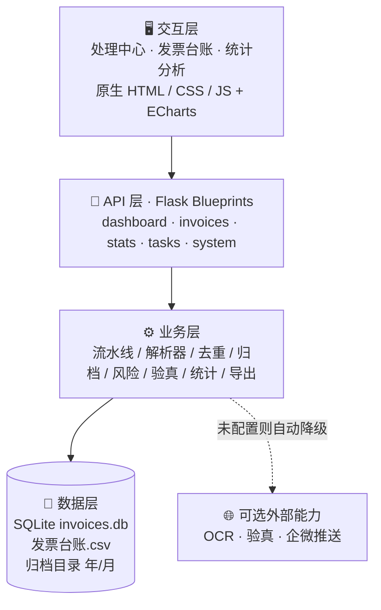

**设计取向**：能本地算的绝不外发，能同步做的绝不引入队列，能用标准库的绝不加重依赖。Flask + SQLite + 原生前端，整套系统不依赖任何需要单独部署的中间件。

### 目录结构

```
├── 🚀 一键启动.bat          # Windows 一键启动
├── api_server.py            # 应用入口
├── build_portable.py        # 绿色便携打包
├── Dockerfile               # 容器化部署
├── 发票台账.csv             # 可直接用 Excel 打开的台账
├── 待识别发票/              # 拖进来就行
├── 已归档发票/              # 按 年/月 自动归位
├── 重复发票记录/            # 拦截留痕
├── 识别失败待处理/          # 失败不静默丢弃
├── .env.example             # 配置模板（所有外部能力均可选）
├── .dockerignore            # 防止 .env / 数据 / 归档被打进镜像
├── docs/                    # 检视报告、修复清单、测试说明、截图
└── system/                  # 核心代码
    ├── api_server.py        # Flask 应用工厂（日志/备份初始化）
    ├── config.py            # 全局配置
    ├── extractor.py         # 提取入口（OFD → 云端 OCR → 文本 → 本地 OCR）
    ├── mcp_server.py        # 本地 MCP Server（5 个只读工具）
    ├── routes/              # 5 组 Blueprint 路由
    ├── core/                # OCR / OFD / PDF / 验真 / 风险 / 模糊去重
    │   ├── local_ocr.py     # RapidOCR 离线识别
    │   └── dedup.py         # RapidFuzz 二次去重
    ├── database/            # SQLite 读写层（WAL + 自动备份）
    ├── services/            # 文件 / 发票 / 同步服务
    ├── components/          # 前端 HTML / CSS / JS
    ├── assets/vendor/       # 本地化的 tailwind / echarts / font-awesome
    └── tests/               # 114 项 pytest 用例 + 手工压测脚本
```

---

<a id="sec-config"></a>

## 🔧 08 · 配置参考

所有外部能力**都是可选的**：不填就自动降级，不影响主流程。

| 变量 | 作用 | 未配置时 |
|:--|:--|:--|
| `BAIDU_API_KEY` / `BAIDU_SECRET_KEY` | 百度 OCR（按次计费） | 回落本地 RapidOCR（离线） |
| `BAIDU_APP_ID` / `BAIDU_OCR_TYPE` | OCR 应用标识 / 类型 | 使用默认 |
| `WECOM_WEBHOOK_URL` | 企微推送地址 | 推送状态记 `skipped`，不伪造成功 |
| `WECOM_SCHEMA` | 推送字段映射（JSON） | `{}` |
| `VERIFY_ENABLED` | 验真开关 | `true` |
| `VERIFY_COST_PER_CALL` | 单次验真费用（仅前端预估） | `0.25` |
| `RETRY_MAX_ATTEMPTS` / `RETRY_DELAY_SECONDS` | 失败重投次数 / 间隔 | `3` / `2` |
| `LOG_LEVEL` / `LOG_MAX_BYTES` / `LOG_BACKUP_COUNT` | 日志级别 / 轮转大小 / 保留份数 | `INFO` / 10MB / 3 |
| `SQLITE_TIMEOUT` / `REQUEST_TIMEOUT` | DB 超时 / HTTP 超时（秒） | `20` / `10` |
| `INVOICE_PROJECT_ROOT` | 项目根目录（便携模式） | 自动检测 |
| `INVOICE_HOST` / `INVOICE_PORT` | 监听地址 / 端口 | `127.0.0.1` / `5000` |
| `ENABLE_ALERT` / `ALERT_WEBHOOK_URL` | 告警推送（预留，未接入） | `false` / 空 |

---

<a id="sec-quality"></a>

## ✅ 09 · 质量与可信度

| 项目 | 状态 | 说明 |
|:--|:--|:--|
| 自动化测试 | ✅ 114 项 pytest 用例 | `system/tests/test_api.py`（需配合临时库运行） |
| 失败重试 | ✅ 有上限 | 失败文件落盘后自动重投，超过 3 次停止自动回流 |
| 错误可读 | ✅ 有 | 技术异常统一映射为中文业务提示 |
| 运行日志 | ✅ 有 | 分级过滤、自动滚动、终端式面板 |
| 数据本地化 | ✅ 有 | 默认全部留在本机 SQLite / CSV |
| 并发安全 | ✅ 有 | SQLite 锁 + 超时控制 |
| 异步处理 | ✅ 有 | 后台线程处理，界面不阻塞 |
| 文档截图 | ✅ 15 张实拍 | 本页全部图片来自真实运行环境 |

```bash
# 注意：test_api.py 使用 system/data 下的真实库；跑之前务必先备份，
# 完整说明见 docs/TESTING.md
python -m pytest system/tests/test_api.py -v

# 极端压力测试是破坏性脚本，必须显式加 --force
python system/tests/manual_stress.py --force
```

---

<a id="sec-extend"></a>

## 🧩 09½ · 两个附加能力

### 本地 MCP Server（让 AI 助手直接问台账）

`system/mcp_server.py` 把台账以 5 个**只读**工具暴露给支持 MCP 的客户端：

| 工具 | 作用 |
|:--|:--|
| `list_invoices` | 按关键词/日期查台账 |
| `get_invoice` | 查单张发票完整字段 |
| `get_stats` | 按日期范围汇总金额与税额 |
| `list_duplicates` | 查被拦截的重复记录 |
| `list_risks` | 查异常发票 |

在 MCP 客户端里配置 stdio 启动即可（零第三方依赖，纯标准库实现）：

```json
{ "command": "python", "args": ["D:/test/invoices/system/mcp_server.py"] }
```

实测返回：`{"count": 11, "total_amount": 156506.93, "seller_count": 10}`。

### 离线优先的识别链路

- **云端 OCR 未配置或失败** → 自动回落 **RapidOCR**（本地 ONNX 模型，随包分发，不联网、不按次收费）
- **OFD 手写解析失败** → **easyofd** 转 PDF 后复用文本/OCR 通道
- **MD5 相同** → 直接拦；**MD5 不同但内容高度相似** → RapidFuzz 二次判定后拦
- **前端三个第三方库**（tailwind / echarts / font-awesome）已本地化到 `system/assets/vendor/`，断网也能正常渲染

---

<a id="sec-scope"></a>

## ⚠️ 10 · 适用边界（说在前面）

好的工具会坦白自己不做什么，SuperSu也一样：

- **定位是个人 / 小团队的轻量工具**，不是企业级财务系统：没有账号体系、没有多租户、没有审批流，也不做总账凭证。
- **云端 OCR / 验真 / 企微推送依赖外部接口，但都有降级路径**：未配置百度 OCR 时，扫描件会回落到本地 RapidOCR（离线、不花钱）；验真与推送则跳过，不影响入库与归档。
- **数据默认只存本地**。只有你主动启用 OCR / 验真时，对应文件才会送给相应接口。
- **单机部署**，不做高可用；重要数据请自行备份 `system/data/invoices.db` 与 `发票台账.csv`。

---

<a id="sec-changelog"></a>

## 🗓 11 · 版本足迹

| 版本 | 日期 | 关键变化 |
|:--|:--|:--|
| **v11.1** | 2026-11-12 | 安全与稳定性修复：上传文件名清洗、CSV 原子写、DB 自动备份、发票号唯一索引、日志初始化、分页参数校验、验真字段修正；新增本地 OCR（RapidOCR）、模糊去重（RapidFuzz）、OFD 兜底（easyofd）、本地 MCP Server、前端资源离线化 |
| **v10.0** | 2026-05-07 | 仪表盘重构 · 快捷筛选与表头排序 · 批量验真确认/结果弹窗 · 自定义统计周期 + 饼图 + CSV 报表 · 风险表格化 |
| **v9.5** | 2026-05-06 | Tab hover 修复 · 详情弹窗「查看原件」恢复 |

> 当前文档基于 **v11.1**（版本号来源：`system/__init__.py:__version__`），截图于 2026-11 在实际运行环境实拍。

---

<a id="sec-faq"></a>

## ❓ 12 · 常见问题

<details>
<summary><b>没有百度 OCR Key，还能用吗？</b></summary>

能。OFD 直接读内嵌 XML，带文本层的 PDF 走本地 pdfplumber 提取，这两条路完全不需要联网。只有扫描件和照片识别需要 OCR Key。验真、企微推送同理，不配置就跳过。
</details>

<details>
<summary><b>支持哪些文件格式？</b></summary>

PDF、OFD、JPG、JPEG、PNG。OFD 走 XML 直读，准确率与速度最好；PDF 优先文本层；图片类走 OCR。
</details>

<details>
<summary><b>数据存在哪里？会不会上传？</b></summary>

本机 `system/data/invoices.db` + 项目根目录 `发票台账.csv` + `已归档发票/年/月/`。默认不外发；仅当启用 OCR / 验真接口时，对应文件才会送出去。
</details>

<details>
<summary><b>端口 5000 被占用怎么办？</b></summary>

设置环境变量 `INVOICE_PORT` 即可（无需改代码）；Docker 方式同时改 `-p` 映射的宿主机端口。
</details>

<details>
<summary><b>便携包怎么给同事用？</b></summary>

`python build_portable.py` 生成 `dist/portable/`，整目录压缩发过去，解压后双击启动脚本即可，对方电脑不需要装 Python。
</details>

---

<p align="center">
  <b>SuperSu · 发票智能处理系统</b><br>
  把重复劳动交给机器，把判断留给人。<br>
  <sub>文档版本 2026-11 · 全部截图实拍于实际运行环境 · 数据演示库为真实台账</sub>
</p>
